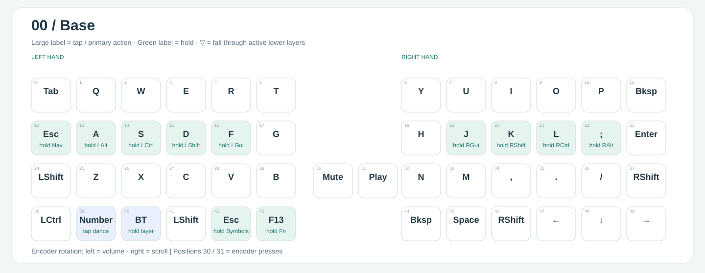
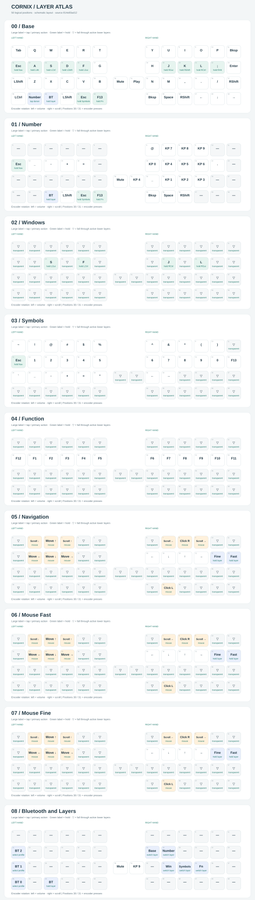
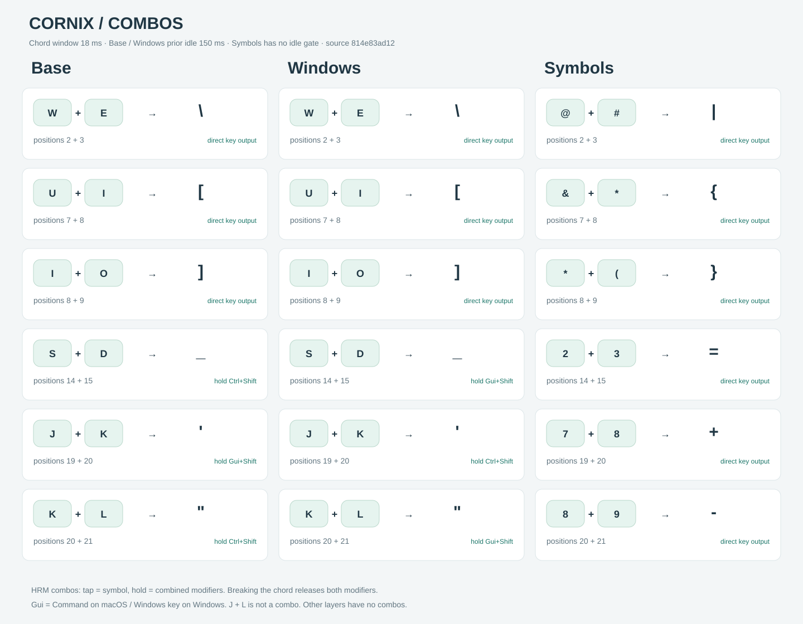

# Cornix · 我的 ZMK 配置

面向 Cornix 分体键盘的日常配置：QWERTY、Home Row Mods、符号 combos，以及数字、导航和鼠标层。键位习惯来自我的 Kanata 配置，使用原生 ZMK 行为实现，在键盘上完成输入处理。

基于 [hitsmaxft/zmk-keyboard-cornix](https://github.com/hitsmaxft/zmk-keyboard-cornix) 的板级支持，HRM 的设计参考 [urob/zmk-config](https://github.com/urob/zmk-config)。固件通过 GitHub Actions 构建，无需本地安装 Zephyr SDK。



## 配置特点

- **左右手 HRM**：字母轻按正常输入，按住作为修饰键；结合输入前空闲保护和按释放位置判定，
减少连打误触。
- **双用途 combos**：S+D、J+K、K+L 并击轻按输出符号，单独长按作为复合修饰键。
- **一致的拇指键**：基础、Windows、Number 和 Symbols 层保持同一组拇指功能。
- **独立导航与鼠标层**：H/J/K/L 移动光标，W/A/S/D 移动鼠标，支持慢速和两倍速。
- **Mac / Windows 模式**：切换 Ctrl 与 GUI 的位置，组合修饰键同步调整。
- **双编码器与 RGB**：音量、滚动、静音及播放控制；RGB 显示电量与连接状态。

## 键位

### 各层一览

| 层 | 进入方式 | 内容 |
| --- | --- | --- |
| Base | 默认；BT 层 H | QWERTY、HRM、符号 combos |
| Number | BT 层 J；底部数字层 tap-dance 键 | 独立数字小键盘及运算符 |
| Windows | BT 层 M | 交换 S/F、J/L 的 Ctrl 与 GUI |
| Symbols | 按住左中拇指；BT 层逗号 | 主行数字、上排符号与符号 combos |
| Function | 按住左手右侧拇指；BT 层句号 | 中排从左到右为 F12、F1–F11 |
| Navigation | 按住 A 左侧的 Esc 键 | 方向、鼠标、滚轮 |
| Mouse Fast | Navigation 下按住最右中排键 | 鼠标两倍速 |
| Mouse Fine | Navigation 下按住分号位置 | 精细移动；与快速键同时按住时优先 |
| Bluetooth | 按住底部 BT 键（位置 40） | 蓝牙设备选择和固定切层 |

图中大字为轻按或主要动作，绿色小字为长按动作；`▽` 表示沿当前激活的下层查找绑定，`—` 表示无动作。编号对应固件中的 50 个逻辑位置，包含编码器按压与辅助键；图为位置示意，不按机身尺寸绘制。GUI 在 macOS 上是 Command，在 Windows 上是 Windows 键。

<details>
<summary>展开全部 9 层键位图</summary>



</details>

[单独打开完整键位图](images/keymap/layers.svg) · [单独打开 combo 图](images/keymap/combos.svg)

### Home Row Mods

| 左手键 | 按住 | 右手键 | 按住 |
| --- | --- | --- | --- |
| A | Alt | J | GUI |
| S | Ctrl | K | Shift |
| D | Shift | L | Ctrl |
| F | GUI | ; | Alt |

采用 `balanced`、`hold-trigger-key-positions` 和 `hold-trigger-on-release`：异手按键按下再释放，可以提前触发修饰键；同手快速滚动倾向保持字母输入。延后到释放时判断位置，也允许叠加同手修饰键。需要同手快捷键时，可以先按住 HRM 超过长按阈值，再按字母。

时间参数集中在 [kanata-timing.h](config/includes/kanata-timing.h)：

| 参数 | 当前值 | 用途 |
| --- | --- | --- |
| HRM 长按 | 280 ms | 未被其他规则提前判定时，转为修饰键 |
| 快速重复 | 175 ms | 快速再次按下同一 HRM 时保留字母重复 |
| HRM 输入前空闲 | 150 ms | 连续打字时优先输出字母 |
| Combo 窗口 | 18 ms | 组合键两次按下的最大间隔 |
| 基础层 combo 输入前空闲 | 150 ms | 普通连打后暂时不触发 combo |

实体 Shift 保留，适合连续文字中的即时大写。Windows 模式将 S/F 改为 GUI/Ctrl，J/L 改为 Ctrl/GUI。

### Combos



基础层的 W+E、U+I、I+O 分别输出反斜杠、左方括号、右方括号。S+D、J+K、K+L 轻按分别为 `_`、`'`、`"`，长按则是图中的双修饰键。

组合 HRM 在通过 combo 空闲保护后，不再重复应用一次空闲保护。任一参与键释放，就释放整个组合的修饰键。J+L 保留为两个独立 HRM，不定义 combo。连续使用共享 K 的组合时，先完整释放上一组按键。

Symbols 层的 combos 不设置空闲保护：主动进入该层即可连续输入符号。因此 18 ms 内重叠按下数字 2+3、7+8、8+9，也会分别得到 `=`、`+`、`-`。其他层不启用 combos。

### 拇指、导航与鼠标

以键盘上从左到右的位置排列：

| 手侧 | 左侧 | 中间 | 右侧 |
| --- | --- | --- | --- |
| 左手 | Left Shift | 轻按 Esc / 按住 Symbols | 轻按 F13 / 按住 Function |
| 右手 | Backspace | Space | Right Shift |

A 左侧的键为轻按 Esc、按住 Navigation。分号右侧为 Enter，Symbols 层该位置改为 F13。Symbols 的拇指使用透明绑定，继承下层功能；双击 Backspace 仍是两次删除。

Navigation 中：

- H/J/K/L：左、下、上、右。
- W/A/S/D：鼠标上、左、下、右。
- Space / I：鼠标左键 / 右键。
- Q/E：向下 / 向上滚动；U/O：向左 / 向右滚动。
- 分号位置：精细移动；其右侧键：两倍速，精细移动优先。

默认鼠标垂直速度为 800、水平速度为 1200 HID 单位/秒；精细模式两轴约 200 单位/秒，滚轮约 33 单位/秒。实际光标距离还受系统加速设置影响。左编码器旋转调节音量，右编码器旋转滚动；基础层按压分别为静音和播放/暂停。

### 蓝牙与主层切换

按住 BT 键（位置 40）：左侧位置 38、24、12 分别选择蓝牙 0、1、2；右侧 H/J/M/逗号/句号分别切到 Base、Number、Windows、Symbols、Function。使用这些固定入口切层后，可通过 BT+H 回到 Base。

如果电脑仍在运行 Kanata，应按设备名排除 Cornix，避免固件输出被再次映射：

```lisp
macos-dev-names-exclude ("Cornix")
```

## 构建与刷写

本仓库同时包含配置和 Cornix 板级模块。[config/west.yml](config/west.yml) 声明 ZMK 与模块依赖，[build.yaml](build.yaml) 声明构建目标。当前基线为 **ZMK `main` / Zephyr 4.1**；依赖跟随 manifest 中的分支，并未固定到单一提交。

在 [Actions](https://github.com/xXxGeorge/cornix_improved/actions) 运行 **Build ZMK firmware**，完成后下载 `firmware` artifact：

| 文件 | 用途 |
| --- | --- |
| `cornix_left_default_nosd.uf2` | 左半主机，包含当前键位 |
| `cornix_right_nosd.uf2` | 右半从机 |
| `cornix_reset.uf2` | 专用 settings-reset 固件 |

让对应设备进入 UF2 模式，复制匹配的固件后重启。日常更新键位不需要清除蓝牙配对。需要清除绑定时，先给相关角色刷入匹配的 settings-reset 固件，再刷回正常固件，最后同时重启两半并重新连接。

当前默认构建为左右分体并启用 `cornix_indicator`。仓库也保留 dongle 支持：`cornix_ph_left//zmk` 为左侧从机，`nice_nano//zmk` 配合 `cornix_dongle_adapter` 作为中央 dongle；按硬件需要再叠加显示 shield。仅在 dongle 板没有提供 `zephyr,display` 时使用 `cornix_dongle_eyelash`。

### 开发与兼容性约定

- 板名使用限定形式：`cornix_left//zmk`、`cornix_right//zmk`、`cornix_ph_left//zmk`、`nice_nano//zmk`。保留旧板型定义。
- nice!nano dongle 和 reset 构建的最终 `.config` 必须有 `CONFIG_NVS=y`、`CONFIG_SETTINGS_NVS=y`，不能有 `CONFIG_SETTINGS_NONE=y`，否则可能丢失蓝牙身份。
- Cornix 自 v2.3 起使用 no-SoftDevice 闪存布局。涉及 `nrf52840-nosd`、旧固件或 bootloader 恢复时，请遵循 [恢复指南](bootloader/README.md)，不要混刷角色或闪存布局。
- DYA Studio 的 BLE 管理、电池历史、settings RPC 和运行时输入处理器模块在 manifest 中声明，ZMK Studio 作为共享 RPC 通道。动态保存过的键位可能覆盖新固件默认映射；需要时在 Studio 中恢复固件默认键位。
- RGB shield 在没有持续指示或动画时延迟 1000 ms 关闭灯珠电源；持续点亮仍会耗电。

## 自定义

| 文件 | 内容 |
| --- | --- |
| [cornix.keymap](config/cornix.keymap) | 各层、鼠标与编码器绑定 |
| [kanata-behaviors.dtsi](config/includes/kanata-behaviors.dtsi) | HRM、层切换与 tap-dance 行为 |
| [kanata-combos.dtsi](config/includes/kanata-combos.dtsi) | 组合键的位置、输出及适用层 |
| [kanata-timing.h](config/includes/kanata-timing.h) | 时间参数和层编号 |
| [cornix54.h](config/includes/cornix54.h) | 50 个逻辑位置的名称 |
| [images/keymap](images/keymap) | 当前键位成品图 |

以 `.keymap` 和 `.dtsi` 为键位来源；旧 JSON 编辑器数据没有同步当前布局，不应反向覆盖它们。`cornix42.keymap` 保留为独立的备用配置。

当前工作副本的绘图工具保存在被 Git 忽略的 `.local/keymap/render.py`。修改键位后运行 `python3 .local/keymap/render.py`，即可重新读取层、行为、位置和 combo 定义，更新三张 SVG；只提交成品图即可。脚本依赖 Python 3 和 clang，无需 ZMK SDK。该本地脚本不随仓库克隆分发；新增不认识的行为会原样显示绑定，需要补充显示规则。

## 致谢

- [urob/zmk-config](https://github.com/urob/zmk-config)：timeless HRM 思路与配置组织方式。
- [hitsmaxft/zmk-keyboard-cornix](https://github.com/hitsmaxft/zmk-keyboard-cornix)：Cornix 板型、shield 和恢复资料。
- [ZMK](https://zmk.dev/docs/) 与 [Kanata](https://github.com/jtroo/kanata)：固件行为与键位设计的基础。
